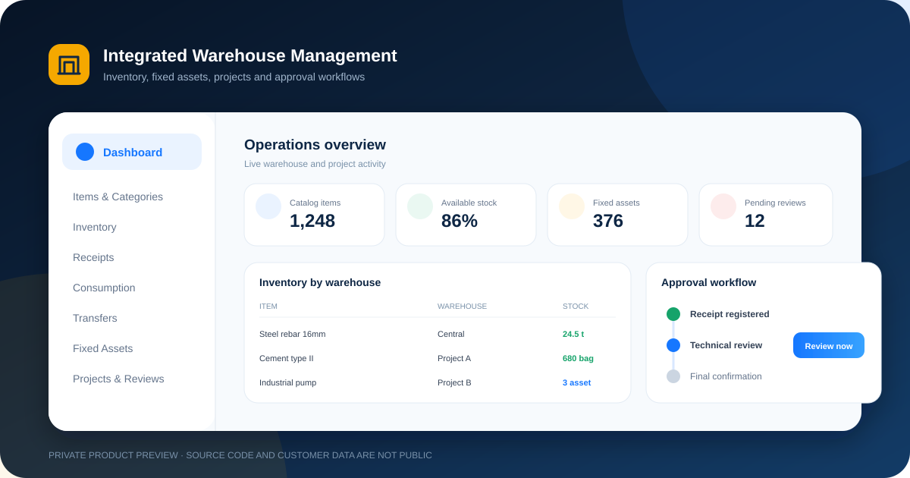
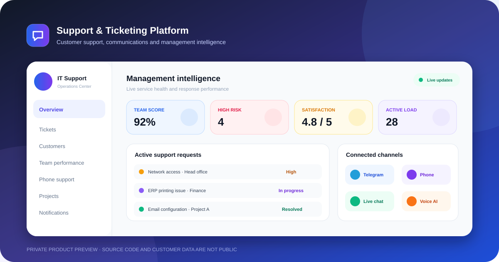

# Amirabbas Abdolrazagh

### Full-Stack Software Developer

Building practical, secure, and scalable business management systems.

---

## About me

I design and develop operational web platforms that turn complex organizational workflows into clear, reliable, and measurable processes. My current work focuses on inventory and asset management, project operations, customer support, workflow approvals, notifications, and role-based access control.

من در زمینه طراحی و توسعه سامانه‌های مدیریتی تحت وب فعالیت می‌کنم؛ با تمرکز بر تبدیل فرایندهای پیچیده سازمانی به گردش‌کارهای ساده، امن و قابل‌اندازه‌گیری.

## Featured private projects

> The repositories below remain private to protect business logic, deployment details, and customer data. Follow this profile for new previews, product updates, and case studies. For a private demo or collaboration, contact me directly.

### Integrated Warehouse Management System

An end-to-end warehouse and project inventory platform for construction operations.

- Central and project warehouse management
- Inventory receipts, consumption, transfers, and stocktaking
- Fixed-asset lifecycle and movement history
- Project-based access and multi-role approval workflows
- Operational dashboard, notifications, Excel imports, and SMS invitations

`Next.js` · `React` · `Node.js` · `MongoDB` · `Role-based Access` · `Workflow Automation`

### Support & Ticketing Platform

A multi-role customer support and service-operation platform built for structured response and measurable team performance.

- Ticket lifecycle, priorities, deadlines, and customer conversations
- Management intelligence and support-team performance analytics
- Telegram notifications and account linking
- Phone-support workflows, call records, and voice transcription
- Project workflows, assessments, proposals, and service handovers

`Next.js` · `React` · `Node.js` · `MongoDB` · `Telegram Integration` · `Operational Analytics`

## Core stack

  
  
  
  
  
  

## Follow the work

Follow this GitHub profile to see upcoming product previews, release highlights, and technical case studies. Source access to private projects is available only by direct agreement.

برای مشاهده پیش‌نمایش‌های جدید، قابلیت‌های منتشرشده و مطالعه‌های موردی آینده، این پروفایل را دنبال کنید. دسترسی به سورس پروژه‌های خصوصی فقط با هماهنگی مستقیم امکان‌پذیر است.

**Open to professional collaboration and private product demos.**

